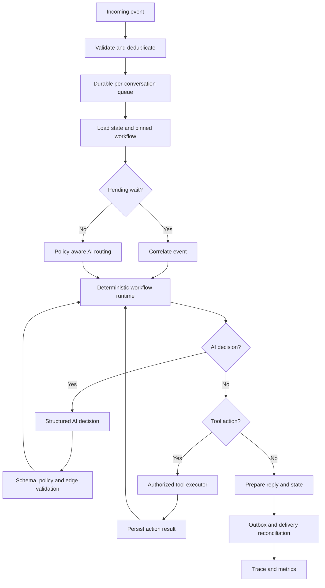

# Agjenti.app — Phase 2: Agentic Orchestration

**Plan teknik për Astra / Cursor Agent — 11 tetor 2026**

**Parakusht:** Përfundo dhe verifiko `AGJENTI_ASTRA_PLAN.md` (Phase 1).

> **Astra:** Analizo kodin real para ndryshimeve. Raporti i mëparshëm ishte auditim statik, jo teste të ekzekutuara. Mos supozo se propozimet më poshtë ekzistojnë. Punë me faza: inspect → design → tests → implement → verify → report. Mos bëj push, deploy, migrim production, pagesa, dërgime reale ose ndryshime secrets pa miratim. Mos mbishkruaj ndryshime lokale.

**Objektivi:** AI propozon vendime dhe veprime; engine validon tranzicionet, autorizon tools, ruan gjendjen dhe rikuperon dështimet. Ruaj workflow builder-in ekzistues, versionimin dhe kompatibilitetin me grafet e publikuara.

**Gate Phase 1:** Duhet të jenë verifikuar unifikimi Instagram/WhatsApp/test, migrimi v2→v3, concurrency, delivery recovery dhe regresionet. Nëse jo, ndalo dhe raporto bllokuesit.

**Kontekst nga auditimi i Cursor:** coordinator schema-v3 përdoret në test dhe production queue; Instagram jashtë pilotit mund të ndjekë legacy path; ekzistojnë suspend/resume dhe persistence, por jo dynamic tool-calling loop. Verifiko në branch-in aktual.


## 1. Arkitektura e synuar



**Invarianta:** LLM nuk bën database writes, nuk thërret API me side effects dhe nuk zgjedh nyje të palejuara pa kontrollin e engine.


## 2. Elementi #1 — Durable Execution

**Qëllimi:** Workflow mbijeton restart, timeout, duplicate webhook dhe retry.

**Hapat:**
1. Inspekto `conversation_states.collected`, `revision`, `processes`, visual/linear cursor, queue dhe commit path. Ripërdor mekanizmat ekzistues.
2. Formalizo statuset `RUNNING`, `WAITING_FOR_INPUT`, `WAITING_FOR_EVENT`, `WAITING_FOR_APPROVAL`, `SUSPENDED`, `HANDOFF`, `COMPLETED`, `FAILED`, `CANCELLED` dhe tranzicionet e lejuara.
3. Ruaj executionId, tenantId, conversationId, workflowVersionId, currentNodeId, revision, pendingPromptId, waitSpec, lastProcessedEventId.
4. Përdor revision compare-and-swap ose transaction locking për state mutations.
5. Projekto transactional outbox ose ekuivalent për reply + state; dallo `PREPARED`, `SENDING`, `SENT`, `FAILED`, `UNKNOWN_DELIVERY`.
6. Për dërgim me rezultat të pasigurt bëj reconciliation; mos ridërgo verbërisht.
7. Mbaj pinned workflow version për ekzekutimet aktive; shto recovery të proceseve të ngecura.

```ts
type ExecutionStatus = 'RUNNING' | 'WAITING_FOR_INPUT' | 'WAITING_FOR_EVENT'
  | 'WAITING_FOR_APPROVAL' | 'SUSPENDED' | 'HANDOFF'
  | 'COMPLETED' | 'FAILED' | 'CANCELLED';
interface ExecutionSnapshot {
  executionId: string; tenantId: string; conversationId: string;
  workflowVersionId: string; currentNodeId: string | null;
  status: ExecutionStatus; revision: number;
  waitSpec?: WaitSpec; pendingPromptId?: string;
  variables: Record<string, unknown>;
}
```

**Teste:** restart gjatë wait, mesazhe paralele, duplicate webhook, send failure, ndryshim grafi, retry pas timeout. **Pranim:** nuk humbet prompt-i dhe side effects nuk dyfishohen.


## 3. Elementi #2 — Deterministic Workflow + Probabilistic AI

**Qëllimi:** AI interpreton, engine kontrollon.

**Hapat:**
1. Analizo `chooseGuidance`, `routeMessage`, `extractMessageFacts`, runtime dhe node handlers.
2. Dallo deterministic gateways, AI decision nodes dhe human approval nodes.
3. Kërko structured output me schema validation: intent, confidence, entities, proposedNextNode, reasonCode.
4. Valido proposedNextNode ndaj edges të grafit, state, tenant permissions dhe business capabilities.
5. Për invalid output, timeout, low confidence ose prompt injection përdor `CLARIFY`, `SAFE_DEFAULT` ose `HANDOFF`.
6. Mos e trajto confidence si provë për veprime me pasoja; verifiko të dhënat dhe kërko konfirmim.
7. AI workflow editing të krijojë draft → validation → tests → human approval → publish, jo live mutations.

```ts
type AiDecision =
 | { kind: 'CONTINUE'; extracted: Record<string, unknown>; confidence: number }
 | { kind: 'ROUTE'; intent: string; targetNodeId: string; confidence: number }
 | { kind: 'CLARIFY'; question: string }
 | { kind: 'ESCALATE'; reasonCode: string };
```

**Teste:** JSON i pavlefshëm, nyje e palejuar, intent i paqartë, ndryshim teme, prompt injection. **Pranim:** vendimet e pavlefshme nuk ndryshojnë state dhe nuk krijojnë side effects.


## 4. Elementi #3 — Wait States & Event Correlation

**Qëllimi:** Mesazhi/eventi rifillon procesin e duhur.

**Hapat:**
1. Projekto `WaitSpec` me waitId, kind, correlationKey, expectedSchema, expiresAt, allowedActors, onTimeout.
2. Mbështet `USER_MESSAGE`, `EXTERNAL_EVENT`, `TIMER`, `HUMAN_APPROVAL`.
3. Correlate sipas tenantId, conversationId, executionId, waitId; jo vetëm teksti.
4. Kontrollo wait-et aktive para routing të ri; dallo përgjigje, sqarim, anulim, staf dhe intent të ri.
5. Sqarimi nuk e mbyll wait-in; intent i ri mund të pezullojë procesin; përgjigjja valide konsumohet një herë.
6. Për disa wait-e të mundshme kërko disambiguation; implemento timeout/cancellation.

```ts
interface WaitSpec {
 waitId: string;
 kind: 'USER_MESSAGE' | 'EXTERNAL_EVENT' | 'TIMER' | 'HUMAN_APPROVAL';
 correlationKey: string; expectedSchema?: string;
 expiresAt?: string; onTimeout?: 'CANCEL' | 'ESCALATE' | 'REMIND';
}
```

**Teste:** rezervim → pyetje për shërbimet → wait mbetet aktiv; porosi e pezulluar → rifillim; duplicate event; event cross-tenant; timeout. **Pranim:** eventet nuk lidhen me execution të gabuar.


## 5. Elementi #4 — Idempotency & Transaction Safety

**Qëllimi:** Retry nuk krijon dy porosi, rezervime ose njoftime.

**Hapat:**
1. Verifiko `webhook_events.external_event_id`, queue claims, send/retry dhe write paths.
2. Dedup sipas provider + account + external event id (ose ekuivalent unik).
3. Krijo idempotency key të qëndrueshme nga tenantId + executionId + nodeExecutionId + actionType.
4. Ruaj action status dhe provider reference pa sekrete.
5. Për timeout pas suksesit të mundshëm bëj reconciliation para retry.
6. Retry vetëm për gabime transient, me backoff/jitter dhe kufi attempts.
7. Për procese shumëhapëshe përdor compensation/saga kur është e mundur; mos supozo rollback midis sistemeve.
8. Kontrollo autorizimin në backend edhe kur AI e ka propozuar veprimin.

**Teste:** workers paralelë, duplicate webhook, timeout pas suksesit në provider, replay. **Pranim:** një action logjik nuk kryhet dy herë ose kalon në status të pasigurt për reconciliation.


## 6. Elementi #5 — Tool Registry & Action Control

**Qëllimi:** AI propozon tools, engine autorizon dhe ekzekuton. **Kjo është aftësi e re**, jo bug fix.

**Hapat:**
1. Inventarizo adapters për katalog, status porosie, kalendar dhe handoff; ripërdori.
2. Krijo registry të versionuar: name, description, input/output schema, requiredCapabilities, riskLevel, timeoutMs, retryPolicy.
3. Krijo ToolExecutor për schema validation, tenant isolation, identity authorization, rate limits, timeout, idempotency dhe structured results.
4. Klasifiko `READ_ONLY`, `REVERSIBLE_WRITE`, `SENSITIVE_WRITE`; shkrimet sensitive kërkojnë konfirmim/miratim.
5. Fillo me `catalog.search` dhe `orders.getStatus` si read-only, me kontroll identiteti.
6. Shto `booking.checkAvailability`; `booking.create` vetëm pas konfirmimit.
7. Kufizo tool calls për turn dhe kohën totale; mos lejo loops të pafundme.
8. Test mode përdor mock adapters për shkrime; mos implemento pagesa/refund pa specifikim të veçantë.
9. Në dështim mos pretendo sukses; përdor fallback/handoff.

```ts
interface ToolDefinition<I = unknown, O = unknown> {
 name: string; version: string; inputSchema: unknown; outputSchema: unknown;
 requiredCapabilities: string[];
 riskLevel: 'READ_ONLY' | 'REVERSIBLE_WRITE' | 'SENSITIVE_WRITE';
 timeoutMs: number;
 execute(input: I, ctx: AuthorizedToolContext): Promise<O>;
}
interface AuthorizedToolContext {
 tenantId: string; conversationId: string; executionId: string;
 actorId?: string; idempotencyKey: string;
}
```

**Teste:** tool i paautorizuar, invalid arguments, tenant mismatch, timeout, duplicate action, hallucinated tool. **Pranim:** çdo tool i ekzekutuar është i autorizuar dhe auditohet.


## 7. Elementi #6 — Observability & Workflow Debugging

**Qëllimi:** Shpjegim i rrugës së ndjekur, vendimeve dhe dështimeve.

**Hapat:**
1. Krijo execution trace të strukturuar me tenantId, conversationId, executionId, messageId, workflowVersionId, nodeId, eventType, status, durationMs, reasonCode, attempt.
2. Eventet: `MESSAGE_RECEIVED`, `ROUTE_DECIDED`, `NODE_ENTERED`, `AI_DECISION_VALIDATED`, `WAIT_CREATED`, `WAIT_RESUMED`, `TOOL_STARTED`, `TOOL_SUCCEEDED`, `TOOL_FAILED`, `REPLY_PREPARED`, `REPLY_SENT`, `EXECUTION_COMPLETED`.
3. Masko PII, tokens, secrets; vendos retention dhe tenant access control.
4. Shto correlation IDs në queue, runtime, tool executor dhe send.
5. Mat success rate, retries, stuck executions, handoff rate, tool latency, token/cost dhe routing fallback.
6. Në Chat Lab ndërto read-only debug view me nyjet e kaluara, arsyen e routing, waits, tool calls dhe gabimet.
7. Në production jep akses vetëm sipas rolit; mos lejo debug UI të ndryshojë state.

**Pranim:** një developer mund të rindërtojë shkakun e një dështimi nga trace, pa kërkuar logs të shpërndara.


## 8. Rendi i implementimit

| Faza | Punimi | Gate / rezultati |
|---|---|---|
| 0 | Auditimi i kodit aktual dhe Phase 1 | Gap report dhe plan |
| 1 | Durable execution | State/recovery tests |
| 2 | Wait states dhe event correlation | Resume/timeout tests |
| 3 | Idempotency dhe transaction safety | Duplicate/retry tests |
| 4 | Structured AI decisions + policy validation | Routing tests |
| 5 | Tool registry dhe read-only tools | Executor tests |
| 6 | Safe write tools + approvals | Confirmation/idempotency tests |
| 7 | Trace, metrics dhe debug UI | End-to-end trace |

**Shënim:** Instrumentimi minimal i trace nis që në fazën 1, jo vetëm në fazën 7. Pas çdo faze kërko raport dhe miratim para vazhdimit.


## 9. Testet end-to-end të detyrueshme

1. Produkt për 4 vjeç → përgjigje nga katalogu pa shpikur çmime.
2. Pyetje për Montessori → ruhet produkti në kontekst.
3. Porosi aktive → pyetje tjetër → rifillim i porosisë.
4. Rezervim → “Çfarë shërbimesh keni?” → wait mbetet aktiv.
5. Biznes pa shërbime → nuk aktivizohet rezervimi.
6. Status porosie pa identitet të verifikuar → nuk ekspozohen të dhëna.
7. Kërkesë për staf → handoff real ose përgjigje pa premtim të rremë.
8. Duplicate webhook → vetëm një përpunim.
9. Dy mesazhe të shpejta → rend dhe state korrekt.
10. Timeout i API-së pas krijimit të rezervimit → reconciliation.
11. Dështim delivery → prompt i rikuperueshëm.
12. Publish i grafit të ri → execution ekzistues mban versionin e vet.
13. Tool i paautorizuar → refuzohet dhe auditohet.
14. Prompt injection → nuk tejkalon politikat.
15. Restart gjatë `WAITING_FOR_INPUT` → rifillim i saktë.
16. Event cross-tenant → refuzohet.
17. Simulatori nuk krijon rezervime/porosi reale.
18. Invalid AI output → fallback, pa side effect.
19. Cancel gjatë një workflow të pezulluar → status korrekt.
20. Gjurmimi i një mesazhi nga webhook deri te delivery është i plotë.


## 10. Formati i raportit që Astra duhet të kthejë pas çdo faze

Për çdo fazë jep:
- **Verified baseline:** skedarë, funksione, rreshta dhe sjellje të verifikuara.
- **Design decision:** çfarë u ripërdor dhe çfarë u shtua, me arsyetim.
- **Changed files:** listë me përmbledhje të ndryshimeve.
- **Migrations:** SQL, backward compatibility, rollback, dhe nëse janë ekzekutuar (default: jo).
- **Tests:** komanda, rezultate, raste të kaluara/dështuara; mos thuaj se kaluan pa i ekzekutuar.
- **Security:** tenant isolation, permissions, secrets, idempotency, data minimization.
- **Risks:** regresione, edge cases, çështje të hapura.
- **Approval gate:** kërko miratim para fazës tjetër ose çdo veprimi production.

**Definition of Done:** funksionet e reja janë të mbuluara me teste; ekziston dokumentim i kontratave; backward compatibility është verifikuar; nuk ka side effects në test; nuk ka deploy pa miratim.


## 11. Prompt i gatshëm për Astra

```text
Read AGJENTI_ASTRA_PLAN.md and AGJENTI_AGENTIC_ORCHESTRATION_PHASE2.md.
Do not modify files yet. Inspect the current repository and verify whether Phase 1
acceptance gates are satisfied. Identify exact code paths, migrations, tests and
remaining blockers. Distinguish confirmed facts from assumptions.

Return:
1) Phase 1 gate checklist with evidence,
2) architecture gap analysis against the six Phase 2 elements,
3) minimal implementation plan for Phase 2 / Stage 1 (Durable Execution),
4) expected files and migrations,
5) tests and rollback strategy,
6) risks and questions requiring approval.

Do not push, deploy, run production migrations, change secrets, or execute
real customer-facing actions. Wait for approval before implementing.
```
